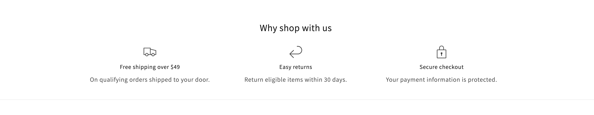

# Shopify Section Library

[](https://github.com/kul3101/shopify-section-library/actions/workflows/ci.yml)

A collection of custom Online Store 2.0 sections built on top of Shopify's [Dawn](https://github.com/Shopify/dawn) theme (v16.0.0). Every section is fully editable in the theme editor, follows Dawn's conventions, and ships with no external JavaScript libraries.

**Live demo:** [devstore-2ze0itgy.myshopify.com](https://devstore-2ze0itgy.myshopify.com/) (storefront password: `awraob`)

## Sections

| Section | What it does | Status |
|---|---|---|
| [Store perks](#store-perks) | A row of icon, heading and text blocks for shipping, returns, guarantees and similar selling points | Done |

More sections are on the way. See the [roadmap](#roadmap).

### Store perks



A grid of short "why buy from us" messages, such as free shipping, easy returns or secure checkout.

**Section settings**

| Setting | Type | Default |
|---|---|---|
| Heading | Inline rich text | Translated default |
| Columns on desktop | Range, 1 to 6 | 3 |
| Color scheme | Color scheme | Scheme 1 |
| Top and bottom padding | Range, 0 to 100 px | 36 px each |

**Perk block settings** (up to 6 blocks)

| Setting | Type |
|---|---|
| Icon | Select, uses Dawn's built-in icon set |
| Heading | Text |
| Text | Rich text |

**Details**

- Responsive grid: 1 column on mobile, 2 on tablet, and the configured count on desktop.
- Empty blocks are hidden on the storefront but stay visible in the theme editor so merchants can still select and fill them.
- The whole section is hidden when no block has content, so an empty section never leaves a gap on the page.
- Respects the theme's "reveal on scroll" animation setting.
- Semantic markup: a `ul` list with `h2` and `h3` headings. Icons are marked `aria-hidden`.
- Padding scales down by 25 percent on mobile, the same way Dawn's own sections do.
- All merchant-facing labels are translation keys in `locales/en.default.schema.json`.
- Excluded from the header and footer section groups.

**Files:** `sections/store-perks.liquid`, `assets/component-store-perks.css`

## Using a section in your own theme

These sections are written for Dawn and Dawn-based themes.

1. Copy the section file from `sections/` and its stylesheet from `assets/` into your theme.
2. Merge the matching `sections.<section-name>` keys from `locales/en.default.schema.json` into your theme's schema locale file.
3. Push the theme, open the theme editor, click **Add section** and pick the section.

## Running locally

Requires [Shopify CLI](https://shopify.dev/docs/api/shopify-cli) and a development store (free with a [Shopify Partner](https://www.shopify.com/partners) account).

```sh
git clone https://github.com/kul3101/shopify-section-library.git
cd shopify-section-library
shopify theme dev --store your-store.myshopify.com
```

## Quality checks

Every push and pull request runs [Theme Check](https://shopify.dev/docs/storefronts/themes/tools/theme-check) in GitHub Actions and fails on any error. To run it locally:

```sh
shopify theme check --fail-level error
```

## Roadmap

- Before and after image slider
- Countdown and announcement timer
- Product bundle ("frequently bought together")
- Size guide drawer
- Testimonials with star ratings
- FAQ with structured data for search results

## Credits and license

Built on [Dawn](https://github.com/Shopify/dawn) by Shopify, which is released under the license in [LICENSE.md](LICENSE.md). That license allows use only for themes that work with Shopify. The sections in this repository are released under the same terms.

## Contact

Available for Shopify theme customization and custom section work. Reach me through my [GitHub profile](https://github.com/kul3101).
